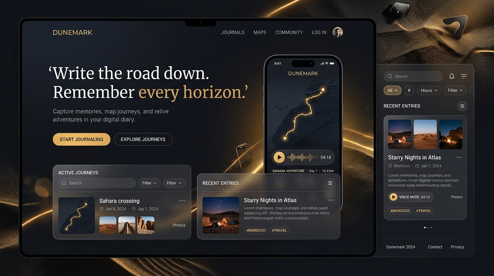

# Personal Developer Portfolio — Bhanu Pratap Jonwar

**OASIS INFOBYTE · Web Development & Designing Internship · Level 1 · Task 2**



---

## 👨‍💻 Developer & Author Profile
- **Name:** Bhanu Pratap Jonwar
- **Role:** Web Developer & UI/UX Designer
- **Academic Background:** Master of Computer Applications (MCA) — ITM University, Gwalior (Ongoing)
- **Internship:** Web Development & Designing Intern at OASIS INFOBYTE
- **Email:** [bhanupratapjonwar@gmail.com](mailto:bhanupratapjonwar@gmail.com)
- **LinkedIn:** [linkedin.com/in/bhanupratapjonwar](https://in.linkedin.com/in/bhanupratapjonwar)
- **GitHub:** [github.com/bhanujonwar](https://github.com/bhanujonwar)

---

## 🌟 Overview & Requirements Adherence
This repository contains Level 1, Task 2: Personal Portfolio for the OASIS INFOBYTE Web Development & Designing Internship. Built purely using vanilla web technologies (**HTML5, CSS3, and vanilla JavaScript**), with **zero external frameworks, zero npm dependencies, and no required development server**.

### Mandatory Deliverables:
1. **Hero Section:** Developer name, role title, real profile portrait (`assets/bhanu.png`), short introduction, and call-to-action buttons.
2. **About Me:** Concise overview of academic journey at ITM University and development focus.
3. **Skills Visual Grid:** Technical skills matrix (HTML5, CSS3, JavaScript, Responsive Design, Git & GitHub, Figma) without self-rated percentages or arbitrary progress bars.
4. **Authentic Projects:** Direct cards for real Oasis Infobyte internship tasks:
   - **Task 1: Dunemark Landing Page**
   - **Task 3: ThermoCraft Temperature Converter**
5. **Contact Hub:** Direct channels (Email, LinkedIn, GitHub) and a validated contact form triggering `mailto:` dispatches.
6. **Fixed Glass Navigation:** Blur on scroll, smooth navigation, active section highlights, accessible mobile hamburger drawer, and high-contrast theme styling.

---

## 🔗 Project Links & Repository Structure
All projects in this internship suite reside within the unified repository:

- **Portfolio (Current Project - Task 2):**  
  [https://github.com/bhanujonwar/OIBSIP/tree/main/WebDev-L1-Portfolio](https://github.com/bhanujonwar/OIBSIP/tree/main/WebDev-L1-Portfolio)
- **Dunemark Landing Page (Task 1):**  
  [https://github.com/bhanujonwar/OIBSIP/tree/main/WebDev-L1-LandingPage](https://github.com/bhanujonwar/OIBSIP/tree/main/WebDev-L1-LandingPage)  
  *Relative local path:* `../WebDev-L1-LandingPage/index.html`
- **ThermoCraft Temperature Converter (Task 3):**  
  [https://github.com/bhanujonwar/OIBSIP/tree/main/WebDev-L1-TemperatureConverter](https://github.com/bhanujonwar/OIBSIP/tree/main/WebDev-L1-TemperatureConverter)  
  *Relative local path:* `../WebDev-L1-TemperatureConverter/index.html`

---

## 🛠️ Honest Feature List
- **High-Contrast Theme System:** Dark and Light visual themes with saved `localStorage` preferences and strictly audited contrast ratios (high-contrast Resume button across both modes).
- **Responsive Navigation:** Fixed glassmorphic navigation bar with mobile brand abbreviation ("Bhanu Pratap") preventing layout wrap on small screens down to 360px.
- **Accessible Mobile Drawer:** Keyboard navigable (Escape key closes), focus-visible styling, `aria-expanded` and `aria-hidden` attributes.
- **Motion Polish with Accessibility:**
  - Dynamic typing role rotator that automatically pauses when `prefers-reduced-motion` is detected.
  - Progressive enhancement scroll reveals that remain 100% visible if JavaScript is disabled.
  - Card hover lifts and micro-animations.
- **Strict Contact Form Validation:**
  - Client-side validation ensuring non-empty name, message (minimum 10 characters), and real email regex (strictly rejecting `notanemail` and `a@b`).
  - Inline error notifications linked via `aria-live="polite"`.
  - Notification banner that informs the user "Opening your email app..." and remains persistently visible across repeated submissions without being hidden.
- **Zero Horizontal Overflow:** Enforced via `html, body { overflow-x: clip; }` and strictly clipped ambient background wrappers.

---

## 🚀 How to Run Locally
No build step, no npm install, and no local server are required.

Simply open `index.html` directly in any modern browser:
```bash
# On Windows PowerShell
start index.html

# Or double-click index.html in File Explorer
```

---

## 📂 File Hierarchy
```
WebDev-L1-Portfolio/
├── assets/
│   ├── bhanu.png                          # Profile photo
│   └── Bhanu_Pratap_Jonwar_Resume.pdf     # Official PDF resume
├── index.html                             # Semantic HTML5 markup
├── style.css                              # External Vanilla CSS3 styles
├── script.js                              # Vanilla ES6+ interactions
├── screenshot.png                         # 1440px desktop rendered preview
└── README.md                              # Project documentation
```
