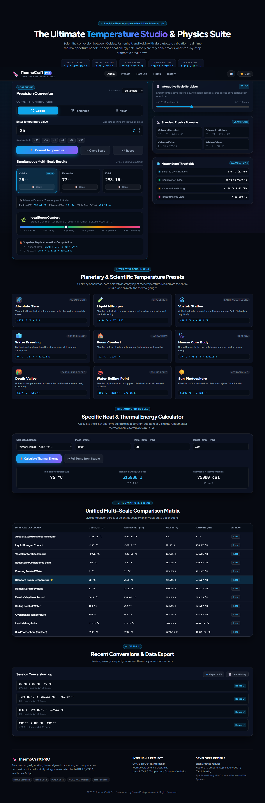

# ThermoCraft Pro — Complete Thermodynamic Suite & Temperature Lab

**OASIS INFOBYTE Internship · Web Development & Designing**  
**Level 1 · Task 3: Temperature Converter Website**  
**Author:** Bhanu Pratap Jonwar (MCA, ITM University)  
**Repository:** `OIBSIP/WebDev-L1-TemperatureConverter/`  

---

## 📸 Application Screenshot



---

## 📖 Overview

**ThermoCraft Pro** is a comprehensive, scientific, and responsive Temperature & Thermodynamic Web Platform engineered with pure semantic **HTML5**, modern **CSS3**, and modular **vanilla JavaScript (ES6+)**. 

Rather than a simple isolated input box, **ThermoCraft Pro** provides an end-to-end thermodynamic laboratory with a floating navigation bar, thermodynamic constants ribbon, precision converter studio, physical state transitions, 9 planetary and extreme benchmark presets, an interactive specific heat energy calculator ($Q = mc\Delta T$), a live multi-scale comparison matrix table, synthesized Web Audio sound feedback, and session history tracking with CSV export.

The web application runs **100% natively in any web browser** with zero frameworks, zero npm dependencies, and zero build tools required.

---

## 🌟 Complete Architecture & Features

### 1. Studio Precision Conversion Engine (OASIS Mandatory Core)
- **Strict Decimal Numeric Validation**: Input field (`type="text"` with `inputmode="decimal"`) strictly validates numeric inputs, rejecting:
  - Letters and words (`"abc"`)
  - Multiple decimal points (`"1.2.3"`)
  - Exponential notation (`"1e3"`)
  - Blank / empty submissions
- **Accessible Live Error Alerts**: Real-time accessible feedback using `role="alert"` with `aria-live="assertive"`, and toggling `aria-invalid="true"`.
- **Absolute Zero Thermodynamic Enforcer**: Identifies physical absolute zero limits (−273.15 °C, −459.67 °F, 0 K) with floating-point epsilon handling (`1e-7`). Out-of-bound inputs display an informative scientific notification and immediately clear results. Boundary values (−273.15 °C, 0 K) remain strictly valid.
- **Simultaneous 3-Scale Results Display**: Dedicated result cards for Celsius (°C), Fahrenheit (°F), and Kelvin (K) update concurrently with active source unit badges and copy buttons.
- **Dual Execution Triggers**: Operates via clicking **Convert Temperature** or pressing **Enter** from the input field.
- **Consistent Rounding & Trailing Zero Trimming**: Values round to 2 decimals by default (or customizable 0–4 decimals) with trailing zeros trimmed (e.g., `25 °C` $\rightarrow$ `77 °F`, `298.15 K`).

### 2. Advanced Physical & Scientific Scales
- **Extended Scales**: Simultaneous output for **Rankine (°R)**, **Réaumur (°Ré)**, and **Water Triple Point offset (ΔK)**.
- **Dynamic Thermal Spectrum Gauge**: Interactive color spectrum (−273.15 °C to 500 °C) with an animated glowing needle and climate classification (*Absolute Zero*, *Cryogenic Deep Freeze*, *Polar Sub-Zero*, *Water Freezing*, *Ideal Room Comfort*, *Human Core Body Heat*, *Water Boiling Point*, *Furnace Incandescence*).
- **Step-by-Step Mathematical Derivation**: Formulates exact arithmetic derivations dynamically for every conversion.

### 3. Planetary & Scientific Benchmark Presets (1-Click Loaders)
Nine 1-click preset cards instantly load real-world and astronomical temperatures into the studio and animate the gauge:
1. **Absolute Zero** (−273.15 °C / 0 K) — Cosmic zero point of entropy
2. **Liquid Nitrogen** (−196 °C) — Cryogenic industrial coolant
3. **Vostok Station** (−89.2 °C) — Earth ground cold record (Antarctica)
4. **Water Freezing** (0 °C / 32 °F) — Solid/liquid phase change
5. **Room Comfort** (22 °C / 71.6 °F) — Standard ambient habitability baseline
6. **Human Core Body** (37 °C / 98.6 °F) — Biological homeostasis
7. **Death Valley** (56.7 °C / 134 °F) — Earth ground heat record
8. **Water Boiling Point** (100 °C / 212 °F) — Vaporization threshold at 1 atm
9. **Sun Photosphere** (5,500 °C / 9,932 °F) — Solar surface temperature

### 4. Specific Heat & Thermal Energy Lab ($Q = mc\Delta T$)
An interactive, connected thermodynamics calculator:
- Select from 7 real physical substances (*Water*, *Aluminum*, *Iron*, *Copper*, *Gold*, *Ethanol*, *Ice*).
- Input mass ($m$) in grams.
- Set initial temperature ($T_1$) and target temperature ($T_2$).
- **"Pull Temp from Studio"** button connects the converter's current Celsius output straight into $T_1$.
- Calculates required thermal energy in **Joules (J)**, **kiloJoules (kJ)**, **calories (cal)**, and **kilocalories (kcal)**!

### 5. Unified Multi-Scale Comparison Matrix Table
- A complete reference table comparing 12 landmark temperatures across Celsius, Fahrenheit, Kelvin, and Rankine.
- **Dynamic Highlighting**: Automatically detects and highlights the row closest to the user's current converter temperature with a star (⭐).
- **1-Click Load Buttons**: Load any landmark row directly into the converter studio.

### 6. Interactive Scale Scrubber Slider & Stepper Controls
- Drag the range slider (−50 °C to 150 °C) to explore real-time temperature changes with instant bidirectional synchronization.
- Stepper buttons (▲ / ▼) adjust by $\pm 1$.
- Quick chip buttons (`−50`, `−10`, `−1`, `+1`, `+10`, `+50`) provide rapid offsets.

### 7. Audit Trail & CSV Export
- Logs conversion history to `localStorage` with timestamps and scales.
- 1-click reload any previous entry back into the studio.
- **CSV Data Export**: Pure JavaScript client-side export to download conversion logs as `.csv`.
- Clear history button.

### 8. Web Audio API & Theme Engine
- **Synthesized Audio**: Subtle, pleasant click and alert tones synthesized on-the-fly using the browser's native `AudioContext` (no external MP3/WAV files needed). Mute toggle available in the navbar.
- **Dark / Light Modes**: Sleek obsidian dark theme and crisp light theme with preference persisted in `localStorage`.

---

## 📐 Mathematical Formulas Reference

| Conversion | Mathematical Formula |
| :--- | :--- |
| **Celsius to Fahrenheit** | $°F = (°C \times \frac{9}{5}) + 32$ |
| **Fahrenheit to Celsius** | $°C = (°F - 32) \times \frac{5}{9}$ |
| **Celsius to Kelvin** | $K = °C + 273.15$ |
| **Kelvin to Celsius** | $°C = K - 273.15$ |
| **Celsius to Rankine** | $°R = (°C + 273.15) \times \frac{9}{5}$ |
| **Celsius to Réaumur** | $°Ré = °C \times \frac{4}{5}$ |
| **Thermal Energy (Heat Transfer)** | $Q = m \cdot c \cdot \Delta T$ |

---

## 🧪 Verified Automated Test Cases (Playwright Verified)

| Input Value | Scale | Celsius | Fahrenheit | Kelvin | Status | Verified Result Detail |
| :--- | :--- | :--- | :--- | :--- | :---: | :--- |
| `25` | Celsius | `25 °C` | `77 °F` | `298.15 K` | **PASS** | Standard room temperature conversion |
| `212` | Fahrenheit | `100 °C` | `212 °F` | `373.15 K` | **PASS** | Boiling point of water matched |
| `0` | Kelvin | `−273.15 °C` | `−459.67 °F` | `0 K` | **PASS** | Absolute zero lower boundary |
| `-273.15` | Celsius | `−273.15 °C` | `−459.67 °F` | `0 K` | **PASS** | Valid boundary conversion |
| `-300` | Celsius | `--` | `--` | `--` | **PASS** | Absolute zero violation alert; results cleared |
| `-460` | Fahrenheit | `--` | `--` | `--` | **PASS** | Absolute zero violation alert; results cleared |
| `-1` | Kelvin | `--` | `--` | `--` | **PASS** | Absolute zero violation alert; results cleared |
| `abc` | Celsius | `--` | `--` | `--` | **PASS** | Rejection: `"Invalid input 'abc'"` |
| `1.2.3` | Celsius | `--` | `--` | `--` | **PASS** | Rejection: `"Input contains multiple decimal points"` |
| `1e3` | Celsius | `--` | `--` | `--` | **PASS** | Rejection: `"Exponential notation is not permitted"` |
| *(empty)* | Celsius | `--` | `--` | `--` | **PASS** | Rejection: `"Please enter a temperature value"` |

### Viewport & Responsiveness Tests (Playwright Suite)

| Viewport Width | `scrollWidth` | `clientWidth` | Horizontal Overflow | Centering Gap Check (1920px) |
| :---: | :---: | :---: | :---: | :---: |
| **1920px** | 1920px | 1920px | **PASS (0px)** | Left: 280.0px, Right: 280.0px (Equal) |
| **1440px** | 1440px | 1440px | **PASS (0px)** | Balanced |
| **1280px** | 1280px | 1280px | **PASS (0px)** | Balanced |
| **1024px** | 1024px | 1024px | **PASS (0px)** | Balanced |
| **768px** | 768px | 768px | **PASS (0px)** | Stacked cleanly |
| **430px** | 430px | 430px | **PASS (0px)** | Mobile adaptive |
| **390px** | 390px | 390px | **PASS (0px)** | Mobile adaptive |
| **375px** | 375px | 375px | **PASS (0px)** | Mobile adaptive |
| **360px** | 360px | 360px | **PASS (0px)** | Mobile adaptive |

---

## 💻 How to Run

1. Clone or download the folder.
2. Double-click or open `index.html` directly in any web browser (Google Chrome, Microsoft Edge, Mozilla Firefox, Safari).
3. **No npm install, no build step, no web server required** — 100% native client-side web application.

---

## 📁 File Structure

```text
WebDev-L1-TemperatureConverter/
├── index.html       # Semantic HTML5 accessible architecture & complete suite
├── style.css        # Pure CSS3 design system, responsive grid, light/dark modes
├── script.js        # Vanilla JavaScript calculation engine, physics lab & tools
├── screenshot.png   # Real 1440px full-page browser capture (780 KB)
└── README.md        # Comprehensive documentation & verified test suite
```

---

## 👨‍💻 Author

**Bhanu Pratap Jonwar**  
Master of Computer Applications (MCA), ITM University  
OASIS INFOBYTE Internship Project
